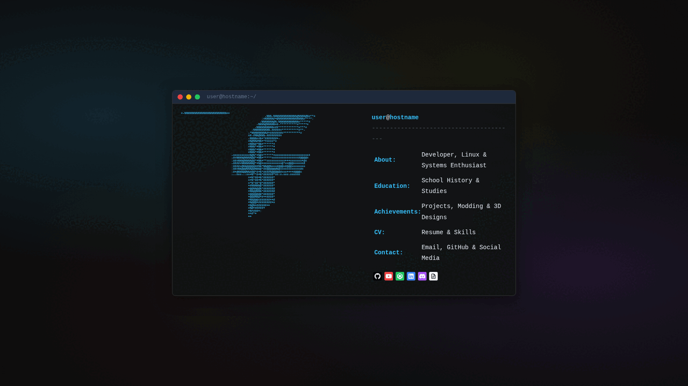
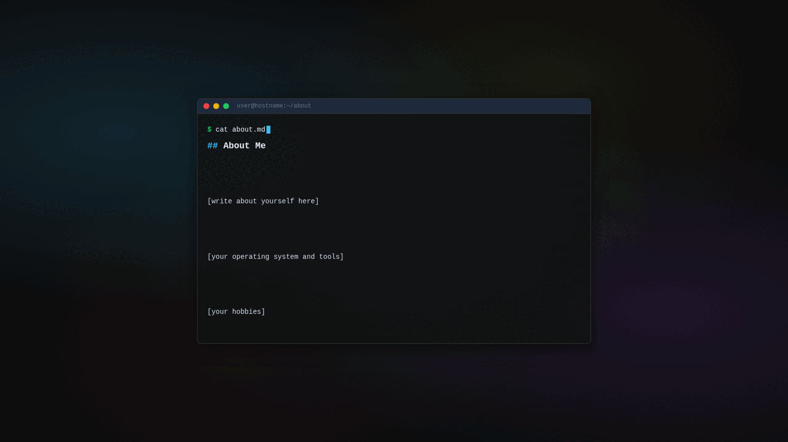
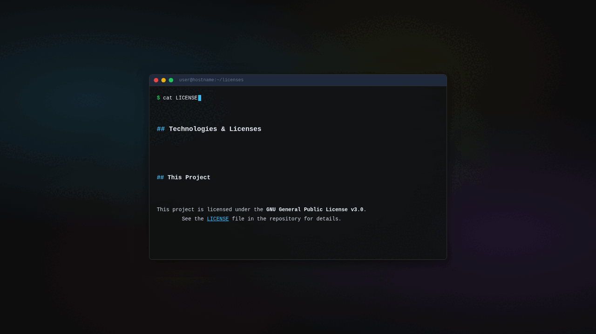

# fetchfolio

A personal portfolio website that looks like a terminal. **neofetch**-style home
page, `$ cat about.md` content pages, and a blinking cursor — all vanilla
HTML/CSS/JS, no build step, no frameworks.

## Screenshots



| Content pages | Licenses (hard-coded, with signature) |
|---|---|
|  |  |

## Features

- Terminal simulation interface (neofetch style) with an ASCII art logo
- ASCII art, user@host, accent color and social links configurable in a
  single file: `fetchfolio.config.yaml`
- Markdown content pages (`about.md`, `education.md`, `achievements.md`,
  `cv.md`, `contact.md`) loaded at runtime
- Terminal-themed 404 page (`cat missing-file.md`)
- `Made by` signature with a GitHub profile link on the licenses page
- Docker deployment (nginx:1.27-alpine base, ~50MB final image)
- GitHub Actions workflow that publishes images to ghcr.io on every push
  and on version tags

## Quickstart

```bash
git clone https://github.com/farukylmz0550/fetchfolio.git
cd fetchfolio
python3 -m http.server 2222
```

Open in your browser: `http://localhost:2222`

## Configuration

Everything lives in ONE file: **`fetchfolio.config.yaml`** (always at the
site root; **`config.js` locates it from any page under any subdirectory**).

```yaml
site:
  version: "1.0.0"
  user: "user"       # user@host in the header; also prefixes page titles
  host: "hostname"

theme:
  accent_color: "#38bdf8"   # any CSS color; drives --ff-accent

# Social links — every box is always visible. Leave a network empty and
# the box stays at the site's homepage; put your own URL to point it there.
social:
  github: ""
  youtube: ""
  makerworld: ""
  linkedin: ""
  discord: ""

# Optional ASCII art override — replaces the home page art when set.
# Keep the |- block form and the leading spaces of the art lines:
# ascii_art: |
#   =-%%%%%%%%%==
#   -%%%-%%%%%==
```

Notes:
- Duplicate YAML keys are NOT silently accepted — `config.js` parses with
  `{ json: true }` and falls back to defaults with a console warning.
- Config edits show up after a plain reload — config and markdown fetches
  use `{ cache: 'no-cache' }`.

## Content pages

Markdown files under `content/` are rendered into the terminal by
`marked.js` (`src/pages/*.html`):

| Page | File |
|---|---|
| About | `content/about.md` |
| Education | `content/education.md` |
| Achievements | `content/achievements.md` |
| CV | `content/cv.md` |
| Contact | `content/contact.md` |

The **licenses page is hard-coded** in `src/pages/licenses.html` — no
markdown, one less network request.

## Project structure

```
├── index.html              # neofetch-style home
├── 404.html                # terminal-themed 404 (nginx error_page target)
├── fetchfolio.config.yaml  # THE single configuration file
├── assets/css/site.css     # all styles (bump ?v=N when you change it)
├── content/*.md            # markdown source of the content pages
└── src/
    ├── js/config.js        # loads + applies the yaml config
    ├── js/load-md.js       # fetches + renders markdown
    ├── js/marked.min.js    # markdown parser (v15.0.12)
    ├── js/js-yaml.min.js   # yaml parser (v4.1.0)
    ├── pages/*.html        # inner pages
    └── icons/*.svg         # social box brand icons (white)
```

## Docker

Self-host the site on any machine:

```bash
docker build -t fetchfolio:latest .
docker run --rm -p 3000:80 fetchfolio:latest
# → http://localhost:3000
```

Or with compose (bind mount keeps `docker-compose.yml` watching the live
files, no rebuild needed):

```bash
docker compose up --build
# → http://localhost:3000
```

## Updating config/assets without touching index.html

When you change `assets/css/site.css` or `src/js/{config,load-md}.js`,
bump the `?v=N` query parameter in the HTML files — browsers keep using
the old cached copy otherwise (browser + nginx cache).

## Releasing

- `main` push and `v*` tags trigger **.github/workflows/docker.yml**,
  which builds and pushes `ghcr.io/<owner>/fetchfolio:{latest,<version>}`
- [Semver](https://semver.org/) is used: breaking changes bump major,
  features minor, fixes patch

### Changelog

- **2.0.0** — breaking: config renamed to `fetchfolio.config.yaml`,
  GitHub Pages support dropped, English-only (TR removed). Features:
  social boxes with brand icons and homepage fallbacks (new LinkedIn),
  `ascii_art` config override, duplicate-key config validation,
  cache-free config/markdown reloads, hard-coded licenses page with a
  "Made by" signature, static ambient background, terminal-themed 404
- **1.0.0** — first official release: unified CSS, social link
  configuration, accessibility improvements, Docker support

## License

This project is licensed under the GNU General Public License v3.0.
See the [LICENSE](LICENSE) file for details. Third-party libraries and
icons are listed on the licenses page (`src/pages/licenses.html`).

## Made by

[farukylmz0550](https://github.com/farukylmz0550)
